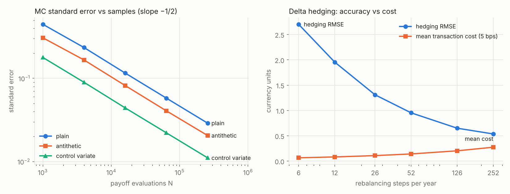

# Monte Carlo Option Pricer

[](https://github.com/3cthulhu3/Monte-Carlo/actions/workflows/tests.yml)

Price European options by Monte Carlo, **prove** the estimates are right against the
Black-Scholes closed form, and study what happens when you try to replicate the option
with discrete delta hedging and transaction costs.

The project is built to be *verifiable*: every Monte Carlo number comes with a standard
error and confidence interval, and the test suite checks the estimators statistically
(agreement within error bars, `1/√N` convergence, CI coverage, hedging error `∝ 1/√steps`).



## What it does

| Area | Functions | What you learn |
|---|---|---|
| Benchmark | `black_scholes_price/delta/gamma` (call & put, σ = 0 handled) | Ground truth for every check |
| Pricing | `monte_carlo_price` → `PricingResult(price, std_error, ci_lower, ci_upper)` | Estimate + error bar |
| Variance reduction | `method="antithetic"` / `"control_variate"`, `variance_reduction_study` | ≈2× and ≈7× efficiency for an ATM call |
| Convergence | `convergence_study`, `estimate_convergence_rate` | Error shrinks like `N^-1/2` |
| Greeks | `monte_carlo_delta_gamma` (finite diff. + common random numbers), `monte_carlo_greeks_pathwise` (pathwise / likelihood-ratio, with SE) | Bias vs variance of Greek estimators |
| Hedging | `hedge_paths`, `simulate_delta_hedge_*`, `run_hedging_frequency_study_with_costs` | Discrete-hedging error vs transaction-cost trade-off |

## Install

Python ≥ 3.10.

```bash
git clone https://github.com/3cthulhu3/Monte-Carlo.git
cd Monte-Carlo
python -m venv .venv
# Linux/macOS: source .venv/bin/activate      Windows: .venv\Scripts\activate
python -m pip install -e ".[dev]"           # numpy + pytest
# optional extras: ".[dev,fast]" (SciPy: faster hedging loop), ".[examples]" (matplotlib)
```

> On Windows `py` works in place of `python`.

## Run

```bash
python -m mc_pricer                 # full report with the default parameters
python -m mc_pricer --quick         # small sample sizes, runs in well under a second
python -m mc_pricer --option-type put --K 110 --sigma 0.3 --method control_variate
python -m mc_pricer --sections pricing greeks --n-sims 500000
python -m mc_pricer --help          # all options
```

After `pip install -e .` the same CLI is also available as `mc-pricer`.

Example output (`python -m mc_pricer`, S0 = K = 100, T = 1, r = 5 %, σ = 20 %):

```text
European call (plain MC) pricing
  Black-Scholes price     : 10.450584
  Monte Carlo price       : 10.420541
  Monte Carlo std. error  : 0.046770
  95% confidence interval : [10.328874, 10.512209]
  |MC - BS|               : 0.030042  (0.64 std. errors)
  CI covers Black-Scholes : yes

Variance reduction (same number of payoff evaluations)
-------------------------------------------------------------------------
         Method |  MC price | Std. error |  |Error| | Efficiency vs plain
-------------------------------------------------------------------------
          plain | 10.420541 |   0.046770 | 0.030042 |               1.00x
     antithetic | 10.467314 |   0.033077 | 0.016731 |               2.00x
control_variate | 10.466844 |   0.017875 | 0.016260 |               6.85x

Many-path delta hedging study, transaction cost = 5.0 bps
-------------------------------------------------------------------------------------------
Steps | Mean error |  Std dev |     RMSE | Mean |error| | Mean cost | Min error | Max error
-------------------------------------------------------------------------------------------
   12 |  -0.089054 | 1.831494 | 1.832743 |     1.394168 |  0.081708 | -8.745462 |  5.248636
   26 |  -0.055595 | 1.301468 | 1.302005 |     0.986404 |  0.107844 | -6.088990 |  4.640986
   52 |  -0.093639 | 0.945735 | 0.949889 |     0.713901 |  0.140779 | -4.182501 |  2.880939
  252 |  -0.282114 | 0.457732 | 0.537491 |     0.408770 |  0.269481 | -1.979116 |  1.349544
```

(The Greeks and convergence tables are omitted here; run it to see them.)

**How to read the hedging table.** Going from 12 to 252 rebalances cuts the RMSE by
about 3.4× but more than triples the cost, and the mean error drifts negative by roughly
the cost paid. Without costs the error spread shrinks like `1/√steps` (checked in the tests);
with costs, the growing cost bias eats part of that gain. "Std dev" is the spread of the
hedging error across paths.

## Use as a library

```python
from mc_pricer import black_scholes_price, monte_carlo_price, monte_carlo_greeks_pathwise

p = dict(S0=100, K=105, T=0.5, r=0.03, sigma=0.25)
res = monte_carlo_price(**p, n_sims=200_000, option_type="put", method="control_variate", seed=0)
print(res.price, res.std_error, res.contains(black_scholes_price(**p, option_type="put")))

g = monte_carlo_greeks_pathwise(**p, n_sims=200_000, option_type="put", seed=0)
print(g.delta, "±", g.delta_se)
```

More in [`examples/quickstart.py`](examples/quickstart.py); `examples/plot_studies.py`
regenerates the figure above.

The original single-file API still works unchanged, e.g.
`price, se, lo, hi = monte_carlo_call_price(100, 100, 1.0, 0.05, 0.2, 100_000, seed=42)`.

## Model and assumptions

- Risk-neutral GBM, `S_T = S0·exp((r − σ²/2)T + σ√T·Z)`, simulated **exactly** on the
  time grid (no Euler error). Constant `r` and `σ`, no dividends, European exercise.
- Confidence intervals use the normal approximation, `price ± z·SE`.
- Control variate: discounted `S_T` (known mean `S0`); its coefficient is estimated from
  the same sample, which adds an `O(1/N)` bias that is negligible at these sample sizes.
- Finite-difference Greeks reuse the same normals for `S0 ± h` (common random numbers);
  they are biased by `O(h²)`. Pathwise delta and the mixed pathwise/likelihood-ratio
  gamma are unbiased and come with a standard error.
- Hedging: the seller receives the Black-Scholes premium, holds the BS delta, rebalances
  at `n_steps − 1` equally spaced dates and pays `transaction_cost_bps` on traded notional.
  The final position is not unwound unless `charge_closing_cost=True` (cash-settled view).
  Hedging uses the true σ, so the error is pure discretisation + cost.
- Reproducibility: every random function takes a `seed`; hedging path `i` uses
  `default_rng(base_seed + i)`.

## Project structure

```text
Monte-Carlo/
├── mc_pricer/
│   ├── __init__.py      # public API (incl. all original names)
│   ├── __main__.py      # python -m mc_pricer
│   ├── cli.py           # argument parsing and the report
│   ├── analytic.py      # Black-Scholes price / delta / gamma
│   ├── simulation.py    # GBM terminal prices and paths
│   ├── pricing.py       # MC pricing, variance reduction, convergence study
│   ├── greeks.py        # finite-difference and pathwise/LR Greeks
│   ├── hedging.py       # vectorised discrete delta hedging with costs
│   ├── report.py        # text tables
│   └── validation.py    # input checks with clear error messages
├── tests/               # 100+ tests incl. statistical checks and regression pins
├── examples/            # quickstart.py, plot_studies.py
├── docs/studies.png
├── .github/workflows/tests.yml
├── pyproject.toml
└── CHANGELOG.md
```

## Tests

```bash
python -m pytest            # ~1 s
```

- **Correctness against theory:** MC within 4 standard errors of Black-Scholes for calls
  and puts, three strikes, all three estimators; Greeks within 4 SE; put-call parity.
- **Statistical behaviour:** fitted SE slope ≈ −0.5; 95 % CI covers the true price in
  ≈ 95 % of 400 independent runs; hedging RMSE slope ≈ −0.5 in the number of steps.
- **Regression:** the numbers produced by the original implementation are pinned
  (`tests/test_regression.py`), so refactors cannot silently change results.
- **Robustness:** invalid inputs raise a `ValueError`/`TypeError` naming the parameter.

All randomness is seeded, so the suite is deterministic.

## Limitations / next steps

Constant volatility only (no smile, no stochastic vol), European payoffs only, no
quasi-Monte Carlo. Natural extensions: path-dependent payoffs (Asian, barrier),
Sobol sequences, hedging under a mis-specified volatility.
